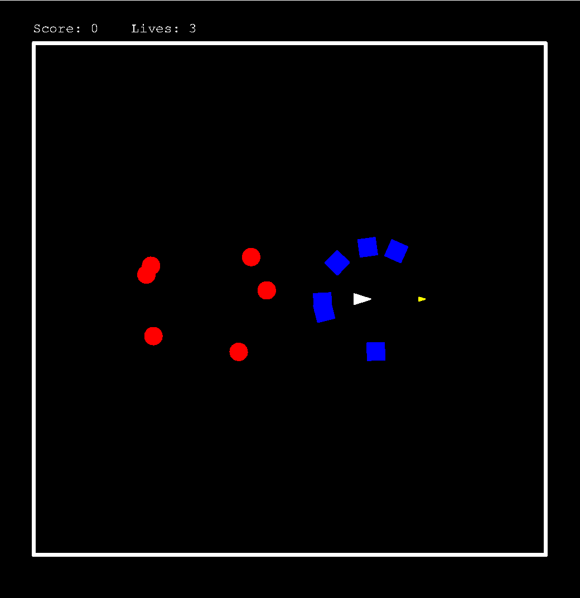

# Python Workshop

I learned Python in middle school by making things I could play or use. This collection brings those games, recreations, and Tkinter experiments together. The current editions repair the old scripts, combine duplicate versions, and finish prototypes such as the music player and phonebook.

## Start with Space War

Steer a white ship around six red enemies and six blue allies. A hit on an enemy earns 100 points and throws orange particles across the arena. Hitting an ally costs 50 points. You have three lives. Use the arrow keys to turn and change speed, Space to fire, and R after game over to play again.



Run the game from the repository root with a desktop Python installation that includes Tk.

```sh
python3 -m tkinter
python3 games/space_war.py
```

Close the Tk test window to continue. On Windows use `py` in place of `python3`. The applications run independently. Tested with Python 3.12 on macOS.

## Two more to try

- **Textpad** grew from a basic notepad into a plain-text editor with line numbers, find and replace, undo, themes, and unsaved-change prompts. Open a file, edit a line, then try closing it. Formatting is for the editing session. [Run or read Textpad](desktop/textpad.py)
- **Hackboard** began as a colour-guessing game. Estimate a swatch’s RGB components in hexadecimal, binary, or decimal, and use higher/lower hints to refine the next guess. A fourth mode asks you to reverse a byte-sized XOR puzzle. [Run or read Hackboard](games/hackboard.py)

## Games

| Game | How to play |
| --- | --- |
| [Space War](games/space_war.py) | Steer, accelerate, and fire while avoiding friendly targets. |
| [Space Invaders](games/space_invaders.py) | Left/right sets your movement direction. Space fires. Clear three rows before they reach you. |
| [Target Chase](games/target_chase.py) | Steer with left/right, accelerate with up, brake with down. Collect all 25 moving targets. |
| [Pong](games/pong.py) | W/S moves the left paddle. The arrow keys move the right paddle. |
| [Snake](games/snake.py) | Use WASD to eat food. A collision resets the round and keeps the session high score. |
| [Tic-tac-toe](games/tic_tac_toe.py) | Two players share a terminal. Choose squares using labels such as T1 or M2. |
| [Quizstar](games/quizstar.py) | Five random questions per round, five points per correct answer. |
| [Hackboard](games/hackboard.py) | Choose the number system and difficulty, then enter a guess. |

## Desktop apps

Run any linked script the same way, for example `python3 desktop/textpad.py`.

| App | What it does |
| --- | --- |
| [Textpad](desktop/textpad.py) | Edit and save UTF-8 text. |
| [Paint](desktop/paint.py) | Draw with a variable-width brush, erase, change paper colour, and export SVG. Optional Pillow adds JPEG and PNG export. |
| [Music player](desktop/music_player.py) | Add your own MP3 or WAV files, select a track, play, pause, skip, and stop. Playback requires pygame and an audio device. |
| [Notebook](desktop/notes.py) | Register a local account and create, edit, or delete multiline notes. Passwords are salted and hashed. Note bodies are stored as plain text. |
| [Phonebook](desktop/phonebook.py) | Keep a local list of names and phone numbers. |
| [Parts inventory](desktop/parts.py) | Track parts, customers, retailers, and prices. |
| [Tasks](desktop/tasks.py) | Add, edit, sort, or randomly choose tasks. Restore deletions within the session. |
| [Numeric shift cipher](desktop/cipher.py) | Experiment with a repeating numeric key and reversible character shifts. |
| [Morse code](desktop/morse.py) | Convert words, numbers, and common punctuation in both directions. |
| [Currency and units](desktop/converter.py) | Convert miles, kilometres, kilograms, pounds, USD, and INR. Supply the exchange rate for currency conversions. |
| [Wikipedia search](desktop/wiki_search.py) | Look up a topic and read its English Wikipedia introduction. |
| [Translator](desktop/translator.py) | Send a short passage to MyMemory for translation between two languages. |
| [Bitcoin tracker](desktop/bitcoin.py) | Refresh the Coinbase BTC/USD spot price and show the change since the previous reading. |
| [Email client](desktop/email_client.py) | Send a message through Gmail using your address and an app password. |
| [Favourite websites](desktop/bookmarks.py) | Open YouTube, a Rubik’s Cube guide, or Google Classroom in your browser. |

Notebook, Tasks, Parts, and Phonebook store records in `~/.python-workshop/records.sqlite3`. Set `PYTHON_WORKSHOP_DATA` to choose a different folder. New notebook accounts use this database. Historical plaintext login files stay outside the repository.

The online tools need internet access. For optional audio playback and raster image export, run `python3 -m pip install pygame Pillow` inside your virtual environment. The other applications use Python’s standard library.

## Checks

```sh
python3 -m compileall -q desktop games tests
python3 -m unittest discover -s tests -v
```

The tests cover text transformations, unit conversion, drawing export, game outcomes, and service response handling. Network and mail transport are simulated in the automated suite.
